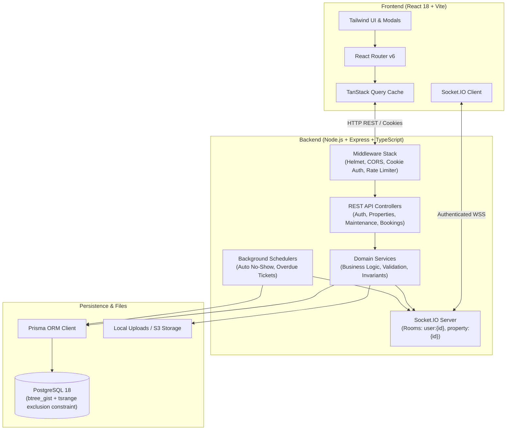

# System Architecture & Technical Design

## 1. High-Level Architecture

EstateSync employs a modern decoupled architecture with a React Single-Page Application (SPA) frontend, an Express REST & WebSocket backend, and a PostgreSQL relational database.



---

## 2. Frontend Architecture

### 2.1 Technology Choices
- **React 18 & Vite**: Fast bundling, ES Modules, and optimal developer ergonomics.
- **Tailwind CSS**: Utility-first styling for a clean, cohesive dashboard interface.
- **TanStack Query (React Query v5)**: Manages remote state, caching, refetching, and automated cache invalidation upon real-time Socket events.
- **React Hook Form & Zod**: Performant, type-safe form validations matching backend schema rules.
- **Recharts**: Responsive SVG charts for owner analytics (occupancy breakdown, ticket priority distribution, amenity utilization).

### 2.2 State & WebSocket Invalidation Pattern
Rather than applying complex optimistic UI mutations that risk drifting from server truth, EstateSync uses an **Event-Driven Cache Invalidation** pattern:
1. When a user submits an action (e.g. creating a booking, updating ticket status), the mutation executes against the REST endpoint.
2. The server commits the change to PostgreSQL and broadcasts a targeted WebSocket event to the relevant room (e.g., `property:${propertyId}`).
3. Connected clients listening on `SocketContext` receive the notification and immediately invalidate relevant React Query keys (`['maintenance']`, `['bookings']`, `['amenities']`, `['dashboard']`).
4. React Query automatically refetches the latest verified data from the database, guaranteeing consistency across all active tenant and staff screens.

---

## 3. Backend & Security Architecture

### 3.1 Middleware Pipeline
1. **Helmet**: Sets security headers (`X-Frame-Options`, `X-Content-Type-Options`, `Content-Security-Policy`).
2. **CORS**: Strict origin whitelist allowing only `CLIENT_ORIGIN` with `credentials: true`.
3. **Cookie Parser**: Reads HttpOnly cookies containing signed JWT sessions.
4. **Rate Limiting**: Defends authentication endpoints and general API routes against brute-force abuse.
5. **Role & Property Membership Guards**:
   - `requireAuth`: Validates JWT session from cookie or Bearer header.
   - `requireRole('OWNER' | 'TENANT' | 'STAFF')`: Enforces role-based permissions.
   - `requirePropertyAccess`: Verifies that an owner owns the property, a tenant holds an active lease at the property, or a staff member is assigned to the property.

### 3.2 Real-Time Room Hierarchy
Every authenticated Socket.IO connection is joined to:
- `user:${user.id}`: Targeted personal alerts (e.g., booking approval notifications, staff ticket assignments).
- `property:${propertyId}`: Property-wide events (e.g., amenity closure broadcasts, new maintenance requests, slot availability updates).

---

## 4. Concurrency & Constraint Model

### 4.1 The Concurrency Problem
When two tenants attempt to book the same facility for overlapping times simultaneously, standard application checks (`SELECT ... WHERE NOT EXISTS ... INSERT`) suffer from race conditions under concurrent execution.

### 4.2 The Database-Level Solution
EstateSync delegates serialization and conflict detection to PostgreSQL:
```sql
ALTER TABLE "AmenityBooking"
ADD CONSTRAINT "no_overlapping_bookings"
EXCLUDE USING gist (
  "amenityId" WITH =,
  tsrange("startsAt"::timestamp, "endsAt"::timestamp) WITH &&
)
WHERE ("status" = 'PENDING_APPROVAL' OR "status" = 'CONFIRMED' OR "status" = 'CHECKED_IN');
```
- **GiST Indexing**: Uses the PostgreSQL `btree_gist` extension to index amenity UUIDs with timestamp ranges.
- **Interval Overlap Operator `&&`**: Evaluates whether `[startA, endA)` overlaps `[startB, endB)`.
- **Atomic Enforcement**: PostgreSQL serializes the index check at disk write time. A concurrent duplicate immediately throws error code `23P01`, which the backend maps to HTTP 409 `BOOKING_CONFLICT`.

---

## 5. Storage Layer Design
- **Local Disk Adapter**: Sanitizes filenames with UUIDs, verifies MIME types against an explicit whitelist (`image/jpeg`, `image/png`, `image/webp`), enforces a 5MB size limit, and serves files securely.
- **S3 Object Storage Adapter**: Abstracted interface allowing zero-code migration to AWS S3 or Cloudflare R2 by setting `STORAGE_DRIVER=s3` and supplying AWS environment variables.
