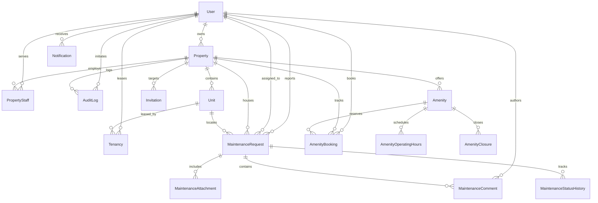

# Database Schema & Entity-Relationship Design

## 1. Entity-Relationship Overview

EstateSync models 16 normalized entities in PostgreSQL via Prisma ORM, enforcing strict referential integrity, unique constraints, and database-level exclusion rules.



---

## 2. Table & Model Definitions

### 2.1 Core Identity & Rental Domain

#### `User`
Primary identity model supporting Owners, Tenants, and Staff.
- `id` (UUID, PK)
- `email` (VarChar, Unique, Indexed)
- `name` (VarChar)
- `passwordHash` (VarChar)
- `role` (`UserRole`: `OWNER`, `TENANT`, `STAFF`)
- `phone` (VarChar, Nullable)
- `createdAt`, `updatedAt` (Timestamps in UTC)

#### `Property`
Real estate asset owned by an `OWNER`.
- `id` (UUID, PK)
- `ownerId` (UUID, FK → `User.id`)
- `name` (VarChar)
- `address` (VarChar)
- `description` (Text, Nullable)
- `timeZone` (VarChar, default `'America/New_York'`)
- `createdAt`, `updatedAt` (Timestamps in UTC)

#### `Unit`
Individual rental apartment or suite.
- `id` (UUID, PK)
- `propertyId` (UUID, FK → `Property.id`)
- `unitNumber` (VarChar)
- `floor` (Integer)
- `description` (Text, Nullable)
- **Constraint**: `@@unique([propertyId, unitNumber])` guarantees no duplicate unit numbers within a property.

#### `Tenancy`
Lease assignment linking a `TENANT` to a `Unit`.
- `id` (UUID, PK)
- `tenantId` (UUID, FK → `User.id`)
- `unitId` (UUID, FK → `Unit.id`)
- `startDate` (DateTime)
- `endDate` (DateTime, Nullable)
- `status` (`TenancyStatus`: `ACTIVE`, `ENDED`, `TERMINATED`)
- **Index**: `@@index([tenantId, status])`

#### `PropertyStaff`
Roster mapping staff members to properties.
- `id` (UUID, PK)
- `propertyId` (UUID, FK → `Property.id`)
- `staffId` (UUID, FK → `User.id`)
- `roleTitle` (VarChar, default `'Maintenance Technician'`)
- **Constraint**: `@@unique([propertyId, staffId])`

#### `Invitation`
Expiring single-use invite tokens.
- `id` (UUID, PK)
- `propertyId` (UUID, FK → `Property.id`)
- `unitId` (UUID, FK → `Unit.id`, Nullable)
- `email` (VarChar, Nullable)
- `role` (`UserRole`)
- `tokenHash` (VarChar, Unique)
- `expiresAt` (DateTime)
- `acceptedAt` (DateTime, Nullable)

---

### 2.2 Maintenance Domain

#### `MaintenanceRequest`
Service ticket filed by a tenant.
- `id` (UUID, PK)
- `propertyId` (UUID, FK → `Property.id`)
- `unitId` (UUID, FK → `Unit.id`)
- `tenantId` (UUID, FK → `User.id`)
- `assignedStaffId` (UUID, FK → `User.id`, Nullable)
- `title` (VarChar)
- `description` (Text)
- `category` (`MaintenanceCategory`: `PLUMBING`, `ELECTRICAL`, `HVAC`, `APPLIANCE`, `STRUCTURAL`, `PEST_CONTROL`, `OTHER`)
- `priority` (`MaintenancePriority`: `LOW`, `MEDIUM`, `HIGH`, `URGENT`)
- `status` (`MaintenanceStatus`: `PENDING`, `IN_PROGRESS`, `COMPLETED`)
- `completedAt` (DateTime, Nullable)
- `createdAt`, `updatedAt` (Timestamps in UTC)

#### `MaintenanceComment`
Threaded discussion messages on a ticket.
- `id` (UUID, PK)
- `requestId` (UUID, FK → `MaintenanceRequest.id`)
- `authorId` (UUID, FK → `User.id`)
- `message` (Text)
- `createdAt` (Timestamp in UTC)

#### `MaintenanceAttachment`
Photo evidence attached to a maintenance ticket.
- `id` (UUID, PK)
- `requestId` (UUID, FK → `MaintenanceRequest.id`)
- `storageKey` (VarChar)
- `mimeType` (VarChar)
- `size` (Integer)
- `uploadedById` (UUID, FK → `User.id`)
- `createdAt` (Timestamp in UTC)

#### `MaintenanceStatusHistory`
Audit record of status transitions.
- `id` (UUID, PK)
- `requestId` (UUID, FK → `MaintenanceRequest.id`)
- `previousStatus` (`MaintenanceStatus`, Nullable)
- `newStatus` (`MaintenanceStatus`)
- `changedById` (UUID, FK → `User.id`)
- `createdAt` (Timestamp in UTC)

---

### 2.3 Amenity & Concurrency-Safe Booking Domain

#### `Amenity`
Shared facility at a property.
- `id` (UUID, PK)
- `propertyId` (UUID, FK → `Property.id`)
- `name` (VarChar)
- `description` (Text, Nullable)
- `location` (VarChar)
- `capacity` (Integer)
- `active` (Boolean, default `true`)
- `approvalRequired` (Boolean, default `false`)
- `slotDurationMinutes` (Integer, default `60`)
- `minimumBookingMinutes` (Integer, default `30`)
- `maximumBookingMinutes` (Integer, default `120`)
- `advanceBookingDays` (Integer, default `14`)
- `cancellationCutoffMinutes` (Integer, default `60`)
- `checkInGraceMinutes` (Integer, default `15`)

#### `AmenityOperatingHours`
Weekly operating hours in property timezone.
- `id` (UUID, PK)
- `amenityId` (UUID, FK → `Amenity.id`)
- `weekday` (Integer, 0=Sunday to 6=Saturday)
- `openingTime` (VarChar, `'HH:mm'`)
- `closingTime` (VarChar, `'HH:mm'`)

#### `AmenityClosure`
Scheduled maintenance blackout windows.
- `id` (UUID, PK)
- `amenityId` (UUID, FK → `Amenity.id`)
- `startsAt` (DateTime)
- `endsAt` (DateTime)
- `reason` (VarChar)

#### `AmenityBooking`
Exclusive reservation slot.
- `id` (UUID, PK)
- `amenityId` (UUID, FK → `Amenity.id`)
- `propertyId` (UUID, FK → `Property.id`)
- `tenantId` (UUID, FK → `User.id`)
- `startsAt` (DateTime)
- `endsAt` (DateTime)
- `attendeeCount` (Integer)
- `status` (`BookingStatus`: `PENDING_APPROVAL`, `CONFIRMED`, `REJECTED`, `CANCELLED`, `CHECKED_IN`, `COMPLETED`, `NO_SHOW`)
- `actualCheckInAt` (DateTime, Nullable)
- `actualCheckOutAt` (DateTime, Nullable)
- `rejectionReason` (VarChar, Nullable)
- `cancellationReason` (VarChar, Nullable)

---

## 3. Database Exclusion Constraint Implementation

The PostgreSQL GiST exclusion constraint enforces non-overlapping bookings:

```sql
CREATE EXTENSION IF NOT EXISTS btree_gist;

ALTER TABLE "AmenityBooking"
ADD CONSTRAINT "no_overlapping_bookings"
EXCLUDE USING gist (
  "amenityId" WITH =,
  tsrange("startsAt"::timestamp, "endsAt"::timestamp) WITH &&
)
WHERE ("status" = 'PENDING_APPROVAL' OR "status" = 'CONFIRMED' OR "status" = 'CHECKED_IN');
```

- Standard intervals use `[)` half-open ranges, allowing back-to-back reservations.
- Partial indexing ignores cancelled, rejected, completed, and no-show entries.
